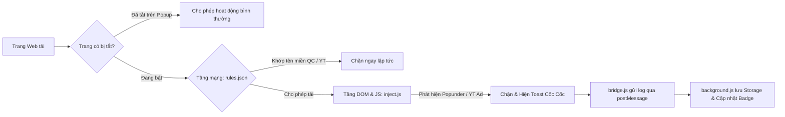

<div align="center">

# 🛡️ AdBlocker by xTer-Inc

**Tiện ích mở rộng chặn quảng cáo, banner, popup & popunder thông minh theo phong cách Cốc Cốc trên nền tảng Manifest V3.**

[](https://github.com/xTer-Inc)
[](https://developer.chrome.com/docs/extensions/mv3/intro/)
[](#)
[](https://github.com/xTer-Inc)
[](https://www.facebook.com/richardisme.us/)

</div>

---

## 📖 Tổng quan

**AdBlocker by xTer-Inc** là tiện ích mở rộng (Browser Extension) gọn nhẹ, hiệu năng cao dành cho các trình duyệt nhân Chromium. Tiện ích hoạt động trên **tất cả các trang web**, giúp loại bỏ triệt để banner quảng cáo, quảng cáo video YouTube, mã theo dõi (tracker) và các kịch bản bật tab quảng cáo ngầm (**Popunder / Auto-Redirect**) thường gặp trên các trang đọc truyện, xem phim trực tuyến.

Thay vì sử dụng hộp thoại cảnh báo truyền thống gây đứng trang (`window.confirm`), tiện ích áp dụng cơ chế **thông báo nổi không chặn luồng (Non-blocking Toast)** ở góc màn hình tương tự trình duyệt Cốc Cốc, đảm bảo trải nghiệm duyệt web mượt mà, không bị gián đoạn.

---

## 🆕 Có gì mới trong phiên bản `1.0.2.0`?

- 🎬 **Chặn quảng cáo YouTube toàn diện như Cốc Cốc:** Chặn request quảng cáo ngay từ tầng mạng (`/pagead/`, `doubleclick.net`), lọc bỏ `adPlacements` trong dữ liệu khởi tạo trình phát và tự động bỏ qua luồng quảng cáo để video phát liền mạch từ đầu.
- 📞 **Sửa lỗi gọi Video Call trên Facebook / Messenger:** Tự động nhận diện và miễn trừ kiểm soát pop-up trên `facebook.com` và `messenger.com`, đảm bảo tính năng gọi video (`facebook.com/messages/`) hoạt động bình thường không bị chặn cửa sổ cuộc gọi.
- 🎚️ **Thanh gạt Bật/Tắt riêng cho từng trang web:** Bổ sung công tắc trực tiếp trên Popup Extension cho phép người dùng tắt nhanh bộ lọc trên những trang web không có quảng cáo hoặc cần tương thích đặc biệt.

---

## ✨ Tính năng nổi bật

- 🌐 **Hoạt động trên mọi trang web (`<all_urls>`):** Bảo vệ toàn diện trên tất cả các tên miền bạn truy cập, kèm công tắc bật/tắt linh hoạt cho từng trang.
- 🚀 **Chặn tận gốc ở tầng mạng (`declarativeNetRequest`):** Triệt tiêu các script quảng cáo, quảng cáo YouTube và mã nhúng popunder ngay từ trước khi trình duyệt tải về.
- 🎨 **Dọn dẹp giao diện sạch sẽ:** Tự động ẩn các vùng chứa banner đầu trang, banner chân trang (catfish), khung quảng cáo YouTube/Google Ads và textlink rác mà không để lại khoảng trống thừa.
- 🛡️ **Chống Popunder & Chuyển hướng ngầm (`MAIN` World):** Ghi đè `window.open` và `HTMLAnchorElement.prototype.click` để vô hiệu hóa hành vi tự động bật tab quảng cáo ẩn khi người dùng nhấp chuột vào bất kỳ vị trí nào trên trang.
- 🔔 **Thông báo nổi kiểu Cốc Cốc:** Khi phát hiện liên kết chuyển hướng ngoài ý muốn, một thanh thông báo nhỏ gọn sẽ trượt ra ở góc trên bên phải màn hình trong 8 giây với tùy chọn **Chặn** hoặc **Cho phép trên trang này**.
- 💾 **Ghi nhớ thông minh theo phiên (`sessionStorage`):** Khi bạn bấm **Cho phép** trên một trang web, tiện ích sẽ ghi nhớ cho suốt phiên làm việc của tab đó (chuyển trang/chuyển chương không hỏi lại) và tự động đặt lại khi đóng tab.
- 📊 **Popup thống kê & Nhật ký chi tiết:**
  - Bộ đếm số lượng quảng cáo đã chặn theo thời gian thực hiển thị trực tiếp trên biểu tượng Extension (**Badge**).
  - Giao diện Popup tối giản tích hợp nút **Xem danh sách đã chặn** (dạng mở rộng/thu gọn) giúp tra cứu chi tiết từng URL quảng cáo, loại chặn, thời gian và tên miền nguồn mà không làm vướng giao diện trang web.
  - Tích hợp nút truy cập nhanh trang **GitHub ([xTer-Inc](https://github.com/xTer-Inc))** và **Facebook ([richardisme.us](https://www.facebook.com/richardisme.us/))** của tác giả.

---

## 🗂️ Cấu trúc thư mục

```text
AdBlocker-by-xTer-Inc/
├── manifest.json       # Cấu hình lõi Extension (Manifest V3, quyền hạn & content scripts)
├── rules.json          # Bộ quy tắc chặn request quảng cáo Web & YouTube ở tầng mạng
├── background.js       # Service Worker quản lý ngoại lệ theo domain, nhật ký & Badge
├── inject.js           # Script chạy ở MAIN world chặn popunder, YouTube ads & hiện Toast UI
├── bridge.js           # Cầu nối ISOLATED world đồng bộ trạng thái Bật/Tắt & log về Storage
├── content.css         # CSS ẩn khung chứa quảng cáo Web/YouTube & định dạng Toast
├── popup.html          # Giao diện bảng điều khiển, công tắc Bật/Tắt & danh sách chi tiết
├── popup.js            # Logic xử lý công tắc theo trang, thống kê & lọc nhật ký trên Popup
└── README.md           # Tài liệu hướng dẫn dự án
```

---

## ⚙️ Kiến trúc & Cơ chế hoạt động



1. **Tầng mạng (`rules.json`):** Sử dụng API `declarativeNetRequest` của Manifest V3 để chặn các request đến máy chủ quảng cáo (`mplmncb.com`, `doubleclick.net`, `googlesyndication.com`, `youtube.com/pagead/`, các endpoint `/popup`, `popunder`, `loader.js`...) với mức tiêu thụ RAM gần như bằng 0.
2. **Tầng DOM & JavaScript (`content.css` & `inject.js`):** Ẩn tức thì các thẻ chứa quảng cáo trên web và YouTube, lọc bỏ dữ liệu quảng cáo trong luồng video YouTube và chặn đứng mọi hàm mở tab ngầm (trong khi vẫn giữ nguyên hoạt động cho các ứng dụng gọi video như Facebook/Messenger).
3. **Đồng bộ & Quản lý theo trang (`bridge.js` & `background.js`):** Mọi lượt chặn đều được gửi qua cầu nối `ISOLATED` world về `chrome.storage.local` (lưu tối đa 200 mục gần nhất). Khi người dùng gạt tắt extension trên một trang web, `background.js` tự động cập nhật `dynamicRules` để miễn trừ hoàn toàn trang web đó.

---

## 🛠️ Hướng dẫn cài đặt (Chế độ nhà phát triển)

1. **Tải mã nguồn:**
   - Nhấn nút **Code** > **Download ZIP** ở góc trên repository này và giải nén ra một thư mục (hoặc sử dụng lệnh Git):
     ```bash
     git clone [https://github.com/xTer-Inc/AdBlocker.git](https://github.com/xTer-Inc/AdBlocker.git)
     ```
2. **Mở trang quản lý tiện ích trên trình duyệt:**
   - **Google Chrome:** Truy cập `chrome://extensions/`
   - **Microsoft Edge:** Truy cập `edge://extensions/`
   - **Cốc Cốc:** Truy cập `coccoc://extensions/`
   - **Brave:** Truy cập `brave://extensions/`
3. **Bật chế độ nhà phát triển:**
   - Gạt bật công tắc **Chế độ dành cho nhà phát triển (Developer mode)** ở góc trên bên phải.
4. **Nạp tiện ích:**
   - Nhấn nút **Tải tiện ích đã giải nén (Load unpacked)** ở góc trên bên trái.
   - Chọn thư mục chứa mã nguồn **AdBlocker by xTer-Inc** vừa giải nén.
5. **Ghim tiện ích:**
   - Nhấn vào biểu tượng mảnh ghép (Extensions) trên thanh công cụ trình duyệt và bấm nút **Ghim (Pin)** bên cạnh **AdBlocker by xTer-Inc** để tiện theo dõi số lượng quảng cáo bị chặn hoặc bật/tắt nhanh theo từng trang web.

---

## 🤝 Đóng góp & Liên hệ

- **GitHub:** [xTer-Inc](https://github.com/xTer-Inc)
- **Facebook:** [richardisme.us](https://www.facebook.com/richardisme.us/)
- **Báo lỗi & Đề xuất:** Nếu bạn gặp trang web nào vẫn còn lọt quảng cáo hoặc popunder mới, hãy mở một **Issue** hoặc gửi **Pull Request** bổ sung tên miền vào `rules.json` và `inject.js` để cùng hoàn thiện bộ lọc!
