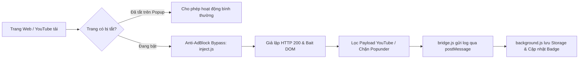

<div align="center">

# 🛡️ AdBlocker by xTer-Inc

**Tiện ích mở rộng chặn quảng cáo, banner, popup & popunder thông minh theo phong cách Cốc Cốc kèm công nghệ vượt qua hệ thống phát hiện trình chặn quảng cáo (Anti-AdBlock Bypass).**

[](https://github.com/xTer-Inc)
[](https://developer.chrome.com/docs/extensions/mv3/intro/)
[](#)
[](https://github.com/xTer-Inc)
[](https://www.facebook.com/richardisme.us/)

</div>

---

## 📖 Tổng quan

**AdBlocker by xTer-Inc** là tiện ích mở rộng (Browser Extension) gọn nhẹ, hiệu năng cao dành cho các trình duyệt nhân Chromium. Tiện ích hoạt động trên **tất cả các trang web**, giúp loại bỏ triệt để banner quảng cáo, quảng cáo video YouTube, mã theo dõi (tracker) và các kịch bản bật tab quảng cáo ngầm (**Popunder / Auto-Redirect**) đồng thời qua mặt các cơ chế quét trình chặn quảng cáo (**Anti-AdBlock**) của YouTube và các website khác.

Thay vì sử dụng hộp thoại cảnh báo truyền thống gây đứng trang (`window.confirm`), tiện ích áp dụng cơ chế **thông báo nổi không chặn luồng (Non-blocking Toast)** ở góc màn hình tương tự trình duyệt Cốc Cốc, đảm bảo trải nghiệm duyệt web mượt mà, không bị gián đoạn.

---

## 🆕 Thông tin bản cập nhật phiên bản `1.0.3.0`?

- 🛡️ **Vượt qua hệ thống quét AdBlock (Anti-AdBlock Bypass Engine):**
  - **Trên YouTube:** Thay vì chặn cứng request ở tầng mạng gây lỗi `ERR_BLOCKED_BY_CLIENT`, extension giả lập phản hồi `HTTP 200 OK` cho các endpoint thăm dò quảng cáo, làm sạch `enforcementMessageViewModel` trong dữ liệu khởi tạo trình phát và tự động gỡ bỏ thông báo *"Trình chặn quảng cáo vi phạm Điều khoản dịch vụ của YouTube"* nếu xuất hiện.
  - **Trên các trang web khác:** Giả lập biến môi trường `window.adsbygoogle` và bảo vệ kích thước DOM (`offsetHeight`, `offsetWidth`) của các phần tử mồi nhử (Bait Elements) để trang web không phát hiện đang bật trình chặn quảng cáo.

---

## ✨ Tính năng nổi bật

- 🌐 **Hoạt động trên mọi trang web (`<all_urls>`):** Bảo vệ toàn diện trên tất cả các tên miền bạn truy cập, kèm công tắc bật/tắt linh hoạt cho từng trang.
- 🎬 **Chặn quảng cáo YouTube toàn diện như Cốc Cốc:** Lọc bỏ `adPlacements` trong phản hồi `/youtubei/v1/player` và tự động bỏ qua luồng quảng cáo để video phát liền mạch từ đầu mà không bị YouTube khóa trình phát.
- 📞 **Tương thích hoàn hảo với Facebook / Messenger Video Call:** Tự động nhận diện và miễn trừ kiểm soát pop-up trên `facebook.com` và `messenger.com`, đảm bảo gọi video (`facebook.com/messages/`) hoạt động bình thường.
- 🚀 **Chặn tận gốc ở tầng mạng (`declarativeNetRequest`):** Triệt tiêu các script mạng quảng cáo phổ biến và mã nhúng popunder ngay từ trước khi trình duyệt tải về.
- 🎨 **Dọn dẹp giao diện sạch sẽ:** Tự động ẩn các vùng chứa banner đầu trang, banner chân trang (catfish), khung quảng cáo YouTube/Google Ads và textlink rác mà không để lại khoảng trống thừa.
- 🛡️ **Chống Popunder & Chuyển hướng ngầm (`MAIN` World):** Ghi đè `window.open` và `HTMLAnchorElement.prototype.click` để vô hiệu hóa hành vi tự động bật tab quảng cáo ẩn khi người dùng nhấp chuột vào bất kỳ vị trí nào trên trang.
- 🔔 **Thông báo nổi kiểu Cốc Cốc:** Khi phát hiện liên kết chuyển hướng ngoài ý muốn, một thanh thông báo nhỏ gọn sẽ trượt ra ở góc trên bên phải màn hình trong 8 giây với tùy chọn **Chặn** hoặc **Cho phép trên trang này**.
- 💾 **Ghi nhớ thông minh theo phiên (`sessionStorage`):** Khi bạn bấm **Cho phép** trên một trang web, tiện ích sẽ ghi nhớ cho suốt phiên làm việc của tab đó và tự động đặt lại khi đóng tab.
- 📊 **Popup thống kê & Nhật ký chi tiết:**
  - Bộ đếm số lượng quảng cáo đã chặn theo thời gian thực hiển thị trực tiếp trên biểu tượng Extension (**Badge**).
  - Thanh gạt **Bật/Tắt riêng cho từng trang web** ngay trên Popup.
  - Nút **Xem danh sách đã chặn** (dạng mở rộng/thu gọn) giúp tra cứu chi tiết từng URL quảng cáo, loại chặn, thời gian và tên miền nguồn mà không làm vướng giao diện trang web.

---

## 🗂️ Cấu trúc thư mục

```text
AdBlocker-by-xTer-Inc/
├── manifest.json       # Cấu hình lõi Extension (Manifest V3, quyền hạn & content scripts)
├── rules.json          # Bộ quy tắc chặn request quảng cáo ở tầng mạng
├── background.js       # Service Worker quản lý ngoại lệ theo domain, nhật ký & Badge
├── inject.js           # Lõi Anti-AdBlock Bypass, chặn popunder, YouTube ads & Toast UI
├── bridge.js           # Cầu nối ISOLATED world đồng bộ trạng thái Bật/Tắt & log về Storage
├── content.css         # CSS ẩn khung quảng cáo Web/YouTube, Bait Elements & Toast
├── popup.html          # Giao diện bảng điều khiển, công tắc Bật/Tắt & danh sách chi tiết
├── popup.js            # Logic xử lý công tắc theo trang, thống kê & lọc nhật ký trên Popup
└── README.md           # Tài liệu hướng dẫn dự án
```

---

## ⚙️ Kiến trúc & Cơ chế hoạt động



1. **Tầng vượt quét Anti-AdBlock (`inject.js` & `content.css`):** Giả lập phản hồi `200 OK` cho các script thăm dò quảng cáo, giữ nguyên kích thước DOM của thẻ mồi nhử và xóa bỏ đối tượng `enforcementMessageViewModel` trước khi YouTube kịp hiển thị cảnh báo khóa trình phát.
2. **Tầng mạng (`rules.json`):** Sử dụng API `declarativeNetRequest` của Manifest V3 để chặn các mạng quảng cáo và popunder bên thứ ba với mức tiêu thụ tài nguyên gần như bằng 0.
3. **Đồng bộ & Quản lý theo trang (`bridge.js` & `background.js`):** Mọi lượt chặn đều được gửi qua cầu nối `ISOLATED` world về `chrome.storage.local` (lưu tối đa 200 mục gần nhất). Khi người dùng gạt tắt extension trên một trang web, `background.js` tự động cập nhật `dynamicRules` để miễn trừ hoàn toàn trang web đó.

---

## 🛠️ Hướng dẫn cài đặt (Chế độ nhà phát triển)

1. **Tải mã nguồn:**
   - Nhấn nút **Code** > **Download ZIP** ở góc trên repository này và giải nén ra một thư mục (hoặc sử dụng lệnh Git):
     ```bash
     git clone [https://github.com/xTer-Inc/AdBlocker.git](https://github.com/xTer-Inc/AdBlocker.git)
     ```
2. **Mở trang quản lý tiện ích trên trình duyệt:**
   - **Google Chrome:** Truy cập `chrome://extensions/`
   - **Microsoft Edge:** Truy cập `edge://extensions/`
   - **Cốc Cốc:** Truy cập `coccoc://extensions/`
   - **Brave:** Truy cập `brave://extensions/`
3. **Bật chế độ nhà phát triển:**
   - Gạt bật công tắc **Chế độ dành cho nhà phát triển (Developer mode)** ở góc trên bên phải.
4. **Nạp tiện ích:**
   - Nhấn nút **Tải tiện ích đã giải nén (Load unpacked)** ở góc trên bên trái.
   - Chọn thư mục chứa mã nguồn **AdBlocker by xTer-Inc** vừa giải nén.
5. **Ghim tiện ích:**
   - Nhấn vào biểu tượng mảnh ghép (Extensions) trên thanh công cụ trình duyệt và bấm nút **Ghim (Pin)** bên cạnh **AdBlocker by xTer-Inc** để tiện theo dõi số lượng quảng cáo bị chặn hoặc bật/tắt nhanh theo từng trang web.

---

## 🤝 Đóng góp & Liên hệ

- **GitHub:** [xTer-Inc](https://github.com/xTer-Inc)
- **Facebook:** [richardisme.us](https://www.facebook.com/richardisme.us/)
- **Báo lỗi & Đề xuất:** Nếu bạn gặp trang web nào vẫn còn lọt quảng cáo hoặc kích hoạt cảnh báo AdBlock mới, hãy mở một **Issue** hoặc gửi **Pull Request** để cùng hoàn thiện bộ lọc!
