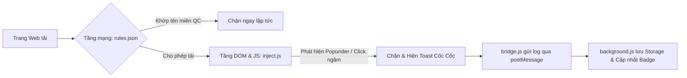

<div align="center">

# 🛡️ AdBlocker by xTer-Inc

**Tiện ích mở rộng chặn quảng cáo, banner, popup & popunder thông minh theo phong cách Cốc Cốc trên nền tảng Manifest V3.**

[](https://github.com/xTer-Inc)
[](https://developer.chrome.com/docs/extensions/mv3/intro/)
[](#)
[](https://github.com/xTer-Inc)

</div>

---

## 📖 Tổng quan

**AdBlocker by xTer-Inc** là tiện ích mở rộng (Browser Extension) gọn nhẹ, hiệu năng cao dành cho các trình duyệt nhân Chromium. Tiện ích hoạt động trên **tất cả các trang web**, giúp loại bỏ triệt để banner quảng cáo, mã theo dõi (tracker) và đặc biệt là các kịch bản bật tab quảng cáo ngầm (**Popunder / Auto-Redirect**) thường gặp trên các trang đọc truyện, xem phim trực tuyến.

Thay vì sử dụng hộp thoại cảnh báo truyền thống gây đứng trang (`window.confirm`), tiện ích áp dụng cơ chế **thông báo nổi không chặn luồng (Non-blocking Toast)** ở góc màn hình tương tự trình duyệt Cốc Cốc, đảm bảo trải nghiệm duyệt web mượt mà, không bị gián đoạn.

---

## ✨ Tính năng nổi bật

- 🌐 **Hoạt động trên mọi trang web (`<all_urls>`):** Bảo vệ toàn diện trên tất cả các tên miền bạn truy cập.
- 🚀 **Chặn tận gốc ở tầng mạng (`declarativeNetRequest`):** Triệt tiêu các script quảng cáo, mạng quảng cáo và mã nhúng popunder ngay từ trước khi trình duyệt tải về.
- 🎨 **Dọn dẹp giao diện sạch sẽ:** Tự động ẩn các vùng chứa banner đầu trang, banner chân trang (catfish), khung quảng cáo Google Ads và textlink rác mà không để lại khoảng trống thừa.
- 🛡️ **Chống Popunder & Chuyển hướng ngầm (`MAIN` World):** Ghi đè `window.open` và `HTMLAnchorElement.prototype.click` để vô hiệu hóa hành vi tự động bật tab quảng cáo ẩn khi người dùng nhấp chuột vào bất kỳ vị trí nào trên trang.
- 🔔 **Thông báo nổi kiểu Cốc Cốc:** Khi phát hiện liên kết chuyển hướng ngoài ý muốn, một thanh thông báo nhỏ gọn sẽ trượt ra ở góc trên bên phải màn hình trong 8 giây với tùy chọn **Chặn** hoặc **Cho phép trên trang này**.
- 💾 **Ghi nhớ thông minh theo phiên (`sessionStorage`):** Khi bạn bấm **Cho phép** trên một trang web, tiện ích sẽ ghi nhớ cho suốt phiên làm việc của tab đó (chuyển trang/chuyển chương không hỏi lại) và tự động đặt lại khi đóng tab.
- 📊 **Popup thống kê & Nhật ký chi tiết:**
  - Bộ đếm số lượng quảng cáo đã chặn theo thời gian thực hiển thị trực tiếp trên biểu tượng Extension (**Badge**).
  - Giao diện Popup tối giản tích hợp nút **Xem danh sách đã chặn** (dạng mở rộng/thu gọn) giúp tra cứu chi tiết từng URL quảng cáo, loại chặn, thời gian và tên miền nguồn mà không làm vướng giao diện trang web.
  - Tích hợp nút truy cập nhanh trang GitHub chính thức của tác giả (**[xTer-Inc](https://github.com/xTer-Inc)**).

---

## 🗂️ Cấu trúc thư mục

```text
AdBlocker-by-xTer-Inc/
├── manifest.json       # Cấu hình lõi Extension (Manifest V3, quyền hạn & content scripts)
├── rules.json          # Bộ quy tắc chặn request quảng cáo ở tầng mạng
├── background.js       # Service Worker xử lý lưu trữ nhật ký và cập nhật Badge
├── inject.js           # Script chạy ở MAIN world chặn popunder & hiển thị Toast UI
├── bridge.js           # Cầu nối ISOLATED world đồng bộ dữ liệu chặn về Storage
├── content.css         # CSS ẩn khung chứa quảng cáo & định dạng thông báo nổi
├── popup.html          # Giao diện bảng điều khiển & danh sách chi tiết trên Extension
├── popup.js            # Logic xử lý thống kê, lọc danh sách và xóa nhật ký trên Popup
└── README.md           # Tài liệu hướng dẫn dự án
```

---

## ⚙️ Kiến trúc & Cơ chế hoạt động



1. **Tầng mạng (`rules.json`):** Sử dụng API `declarativeNetRequest` của Manifest V3 để chặn các request đến máy chủ quảng cáo (`mplmncb.com`, `doubleclick.net`, `googlesyndication.com`, các endpoint `/popup`, `popunder`, `loader.js`...) với mức tiêu thụ RAM gần như bằng 0.
2. **Tầng DOM & JavaScript (`content.css` & `inject.js`):** Ẩn tức thì các thẻ chứa quảng cáo trên trang và tiêm script vào `MAIN` world ngay tại thời điểm `document_start` để chặn đứng mọi hàm mở tab ngầm trước khi script của trang web kịp khởi chạy.
3. **Đồng bộ & Thống kê (`bridge.js` & `background.js`):** Mọi lượt chặn đều được gửi qua cầu nối `ISOLATED` world về `chrome.storage.local` (lưu tối đa 200 mục gần nhất) và cập nhật trực tiếp lên Badge của tab hiện tại.

---

## 🛠️ Hướng dẫn cài đặt (Chế độ nhà phát triển)

1. **Tải mã nguồn:**
   - Nhấn nút **Code** > **Download ZIP** ở góc trên repository này và giải nén ra một thư mục (hoặc sử dụng lệnh Git):
     ```bash
     git clone [https://github.com/xTer-Inc/AdBlocker.git](https://github.com/xTer-Inc/AdBlocker.git)
     ```
2. **Mở trang quản lý tiện ích trên trình duyệt:**
   - **Google Chrome:** Truy cập `chrome://extensions/`
   - **Microsoft Edge:** Truy cập `edge://extensions/`
   - **Cốc Cốc:** Truy cập `coccoc://extensions/`
   - **Brave:** Truy cập `brave://extensions/`
3. **Bật chế độ nhà phát triển:**
   - Gạt bật công tắc **Chế độ dành cho nhà phát triển (Developer mode)** ở góc trên bên phải.
4. **Nạp tiện ích:**
   - Nhấn nút **Tải tiện ích đã giải nén (Load unpacked)** ở góc trên bên trái.
   - Chọn thư mục chứa mã nguồn **AdBlocker by xTer-Inc** vừa giải nén.
5. **Ghim tiện ích:**
   - Nhấn vào biểu tượng mảnh ghép (Extensions) trên thanh công cụ trình duyệt và bấm nút **Ghim (Pin)** bên cạnh **AdBlocker by xTer-Inc** để tiện theo dõi số lượng quảng cáo bị chặn.

---

## 🤝 Đóng góp & Liên hệ

- **Tác giả:** [xTer-Inc](https://github.com/xTer-Inc)
- **Báo lỗi & Đề xuất:** Nếu bạn gặp trang web nào vẫn còn lọt quảng cáo hoặc popunder mới, hãy mở một **Issue** hoặc gửi **Pull Request** bổ sung tên miền vào `rules.json` và `inject.js` để cùng hoàn thiện bộ lọc!
